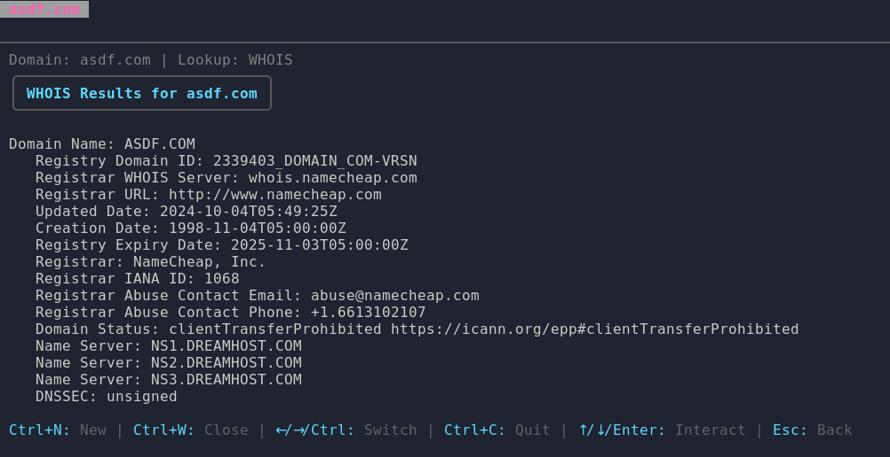

# DNS & WHOIS Lookup TUI

A terminal application built with Go and Bubble Tea for DNS lookups, RDAP/WHOIS queries and watching records change — in an interactive, tabbed TUI or headless for scripts.



## Features

* **Interactive TUI** with tabs — one per domain/IP, all lookups run in parallel (at most 8 at once).
* **Native DNS** — A, AAAA, CNAME, MX, NS, SOA, TXT, CAA, PTR, SPF, DMARC and ANY are resolved in Go (no `dig` needed). PTR on an IP does a reverse lookup.
* **RDAP** — structured registration data over HTTPS (registrar, status, dates, nameservers; network/range/country for IPs).
* **NSLOOKUP / WHOIS** via the system tools, if installed.
* **Comprehensive Report** — runs every lookup for a target and combines the results.
* **Watch mode** — re-run a lookup on an interval; new lines are highlighted (`+`), removed ones listed (`-`), and background tabs that changed get a `●` marker.
* **Custom DNS server** — per tab in the TUI (`s`) or with `--server`.
* **Headless mode** — `-o text|json` prints results and exits, for scripting and pipelines.
* **Export & copy** — save one tab or all tabs to a file, or copy the result to the clipboard.
* **Configurable keybindings** via YAML, with conflict detection.

## Prerequisites

DNS and RDAP lookups need nothing extra. The `NSLOOKUP` and `WHOIS` lookups need those commands on your `PATH`:

* **Debian/Ubuntu:** `sudo apt install dnsutils whois`
* **Fedora/RHEL:** `sudo dnf install bind-utils whois`
* **macOS:** both are included.

DNS queries go to the servers in `/etc/resolv.conf`. Where that file doesn't exist (Windows), dlookup falls back to `1.1.1.1` and `8.8.8.8` — pass `--server` to use a different resolver.

## Installation

### From GitHub Releases

Download the archive for your platform from the [Releases page](https://github.com/kristiand00/dlookup/releases), e.g. `dlookup_<version>_darwin_arm64.tar.gz`, `dlookup_<version>_linux_amd64.tar.gz` or `dlookup_<version>_windows_amd64.zip`. Verify it against `checksums.txt`, extract it, and put `dlookup` on your `PATH`.

> Releases before this change shipped raw binaries named like `dlookup-macos-arm64`; they are now archives with `darwin` instead of `macos`.

### From source

Requires Go 1.24.2 or newer.

```bash
git clone https://github.com/kristiand00/dlookup.git && cd dlookup && go build -o dlookup .
```

## Usage

```
dlookup [options] [target ...]
dlookup [options] --<lookup> FILE [target ...]
dlookup -o text|json --lookup <lookup> [options] target ...
```

Files contain one target per line; blank lines and `#` comments are ignored. Use `-` as the file (or as a target) to read from stdin. Invalid targets are skipped with a warning.

### Interactive

```bash
dlookup                                 # empty tab, type a domain/IP
dlookup example.com 1.1.1.1             # a tab per target, pick the lookup in the TUI
dlookup --dig-a domains.txt extra.com   # run DIG (A) on every target, one tab each
dlookup --report domains.txt --server 1.1.1.1
```

### Headless

```bash
dlookup -o json --lookup dig-mx example.com
cat domains.txt | dlookup -o text --lookup rdap -
dlookup -o text --dig-a domains.txt --server 1.1.1.1 --timeout 5s --concurrency 4
```

Results are printed in input order. Exit code is `0` on success, `1` if any lookup failed, `2` on usage errors. JSON output is an array of `{"target", "lookup", "output", "error", "duration_ms"}`.

### Options

| Flag | Description |
| --- | --- |
| `--<lookup> FILE` | Run that lookup on targets from FILE (only one at a time) |
| `--lookup NAME` | Select the lookup by flag name (e.g. `dig-mx`) for positional targets |
| `-o`, `--output text\|json` | Headless mode |
| `--server HOST[:PORT]` | DNS server to query (default: system resolver) |
| `--timeout DURATION` | Per-lookup timeout (default `15s`) |
| `--concurrency N` | Headless: parallel lookups (default 8) |
| `--version` | Print version |

**Lookup flags:** `--dig-a`, `--dig-aaaa`, `--dig-any`, `--dig-caa`, `--dig-cname`, `--dig-dmarc`, `--dig-mx`, `--dig-ns`, `--dig-ptr`, `--dig-soa`, `--dig-spf`, `--dig-txt`, `--nslookup`, `--rdap`, `--whois`, `--report`. Run `dlookup --help` for the full list.

`DIG (ANY)` is available on its own but left out of the Report, since most resolvers refuse ANY queries (RFC 8482).

## Keybindings

Defaults are shown below; the help bar at the bottom always reflects your configured keys. `esc` always works as back/cancel, and printable keys are typed normally while an input is focused.

| Key | Action |
| --- | --- |
| `ctrl+c` | Quit |
| `n` | New tab |
| `x` | Close tab |
| `←` / `→` | Previous / next tab |
| `enter` | Confirm (domain input, lookup selection, dialogs) |
| `q` / `esc` | Back (stops watch mode; cancels a running lookup) |
| `↑` `↓` `PgUp` `PgDn` `g` `G` | Scroll results |
| `w` | Start watch mode (prompts for interval) / stop watching |
| `s` | Set DNS server for this tab (empty = system default) |
| `y` | Copy result to clipboard |
| `ctrl+x` | Export this tab's result (filename pre-filled) |
| `ctrl+e` | Export all tabs to `./dlookup-all-<timestamp>.txt` |

Mouse capture is off, so you can select and copy text with your terminal as usual.

## Configuration

The config lives at `~/.config/dlookup/config.yaml` on Linux and macOS (`%AppData%\dlookup\config.yaml` on Windows) and is created with defaults on first run:

```yaml
keybindings:
  quit: ctrl+c
  new_tab: "n"
  close_tab: x
  next_tab: right
  prev_tab: left
  back: q
  confirm: enter
  watch_toggle: w
  export: ctrl+x
  export_all: ctrl+e
  copy: "y"
  server: s
```

Keys missing from the file use their defaults. Empty or duplicate bindings are reported on startup, reset to defaults and the file is updated — configs from older versions (where `close_tab` and `watch_toggle` were both `w`) are fixed automatically. See the [Bubble Tea key names](https://github.com/charmbracelet/bubbletea) for supported keys (`ctrl+a`, `alt+b`, `f1`, `space`, …).

## Development

```bash
go vet ./...
go test -race ./...
```

CI runs vet, tests, golangci-lint and cross-platform builds on every PR. Releases are built by GoReleaser when a `v*.*.*` tag is pushed.

## License

MIT — see `LICENSE`.

## Acknowledgements

* [Charm](https://charm.sh/) — Bubble Tea, Bubbles and Lip Gloss.
* [miekg/dns](https://github.com/miekg/dns) — DNS library.
* [go-yaml/yaml](https://github.com/go-yaml/yaml) — YAML parsing.
